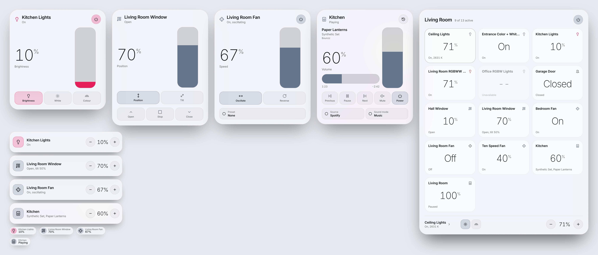

# Liquid Home

Liquid glass cards for Home Assistant lights, covers, fans and media players: a light card, a cover card, a fan card, a media card, a tile, a badge and a room card.

<picture>
  <source media="(prefers-color-scheme: dark)" srcset="https://raw.githubusercontent.com/decibel95/liquid-home/main/docs/public/media/readme/hero-dark.png">
  <source media="(prefers-color-scheme: light)" srcset="https://raw.githubusercontent.com/decibel95/liquid-home/main/docs/public/media/readme/hero-light.png">
  
</picture>

<sub>From left to right: light card, cover card, fan card, media card, tile and badge, and room card.</sub>

Requires Home Assistant 2025.1 or newer.

<!-- ha-marketplace:exclude-start -->
## Install

[](https://my.home-assistant.io/redirect/hacs_repository/?owner=decibel95&repository=liquid-home&category=plugin)

**Home Assistant Marketplace (2026.11 and newer).** Open Settings, Marketplace, search for **Liquid Home** and install it. The dashboard resource is added for you.

**HACS (older versions).** Search for **Liquid Home** in HACS, download it and reload the browser.

If the search does not find it, add `https://github.com/decibel95/liquid-home` from a link (Marketplace: **Add from link**, type Dashboard) or as a custom repository in HACS (category Dashboard).

**Manual.** Download `liquid-home.js`, `liquid-inter.woff2` and `liquid-inter-OFL.txt` from the [latest release](https://github.com/decibel95/liquid-home/releases/latest) into `/config/www/liquid-home/`. Under Settings, Dashboards, three dots, Resources, add `/local/liquid-home/liquid-home.js` as a JavaScript module and hard refresh. If the card does not update, see [Troubleshooting](https://decibel95.github.io/liquid-home/troubleshooting).
<!-- ha-marketplace:exclude-end -->

## Use

Edit a dashboard, add a card and pick **Liquid Home**. Or in YAML:

```yaml
type: custom:liquid-home-light-card
entity: light.kitchen_lights
```

## Documentation

All options, theming, languages and troubleshooting: [decibel95.github.io/liquid-home](https://decibel95.github.io/liquid-home/).

## On the roadmap

What we are working on. Plans can change.

- Speaker grouping (planned).
- Sensor and device cards (planned).

Missing something? Feature requests and ideas are welcome: [open an issue](https://github.com/decibel95/liquid-home/issues/new/choose).

## Liquid family

<!-- When a new Liquid repo is created, add its row to this table in every Liquid README. -->

| Project | What it is |
| --- | --- |
| [Liquid Climate](https://github.com/decibel95/liquid-climate) | Glass cards for climate, water heater and humidifier entities (Home Assistant, HACS) |
| **Liquid Home** (this repo) | Glass cards for lights, covers, fans and media players (Home Assistant, HACS) |
| [liquid-core](https://github.com/decibel95/liquid-core) | Shared design library behind the Liquid cards (npm) |

## License

[MIT](LICENSE). The Liquid Inter font is under the SIL Open Font License 1.1 and the Lucide icons under the ISC license, see [NOTICE](NOTICE).
