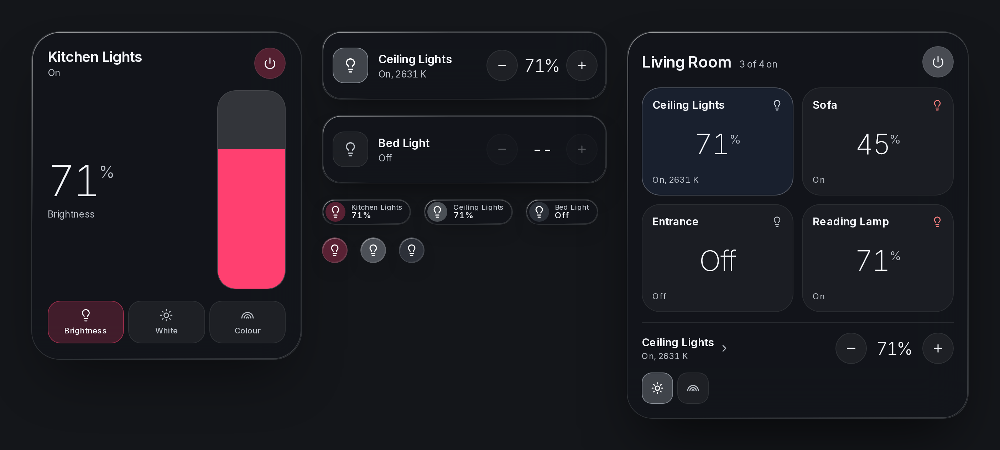
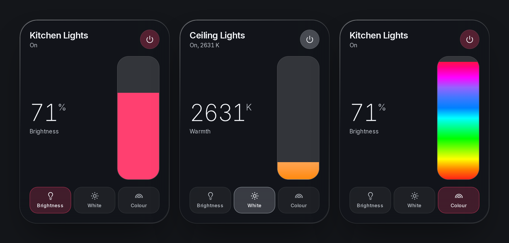
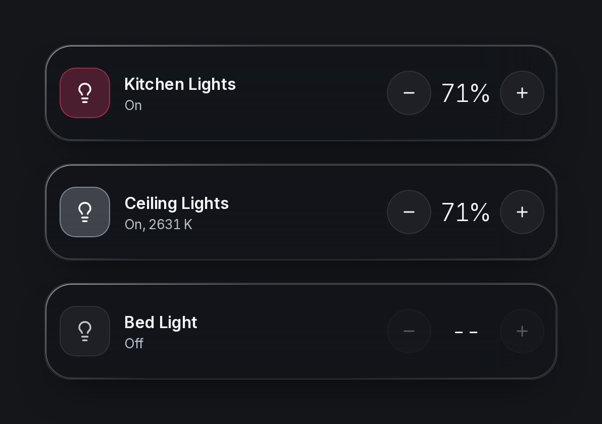
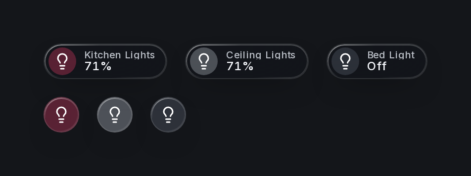
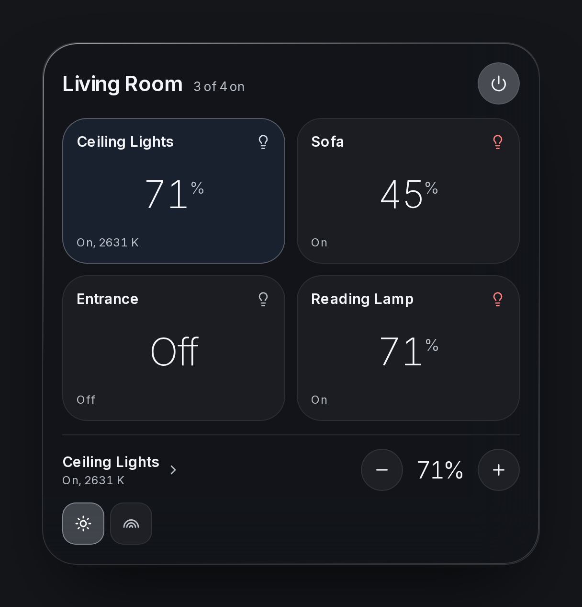
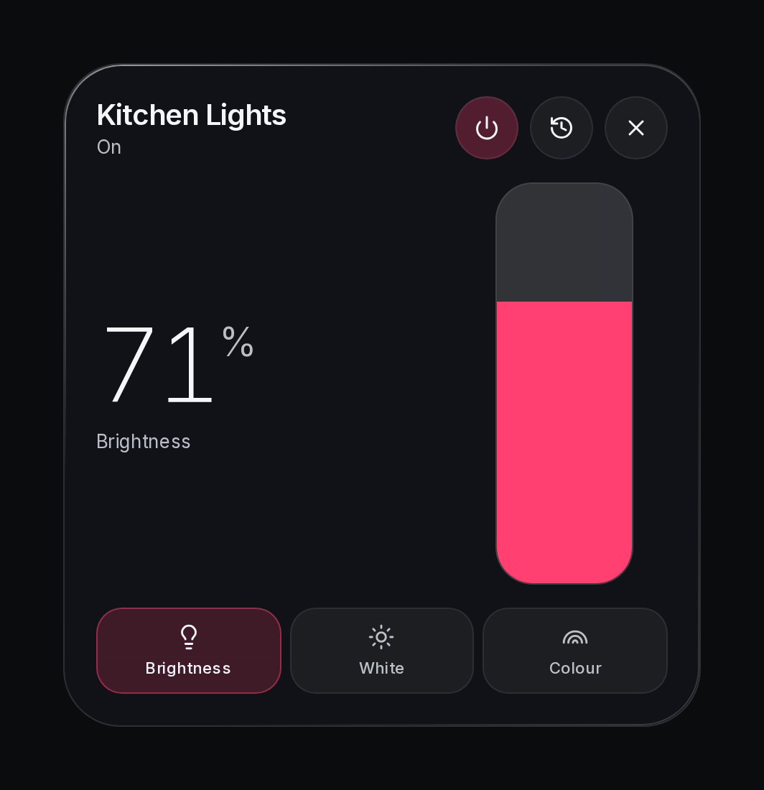
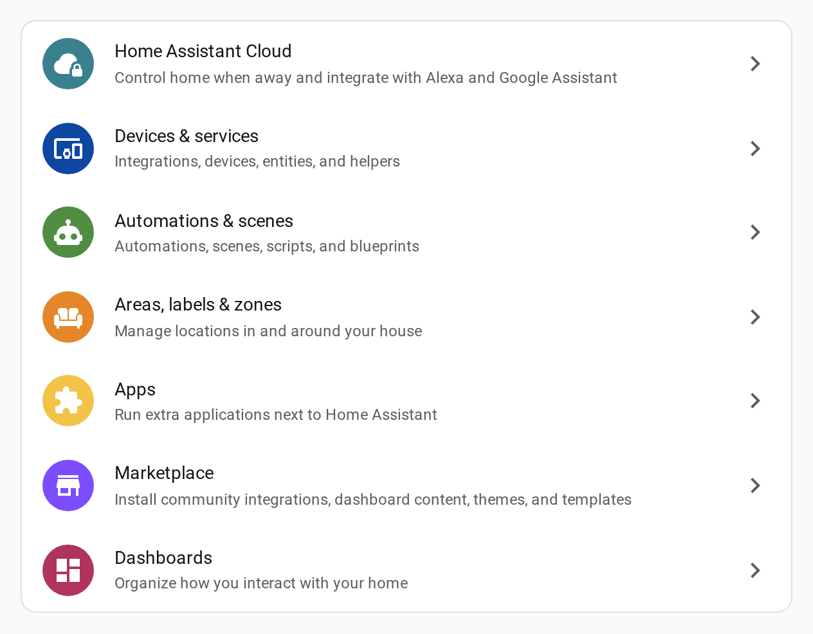
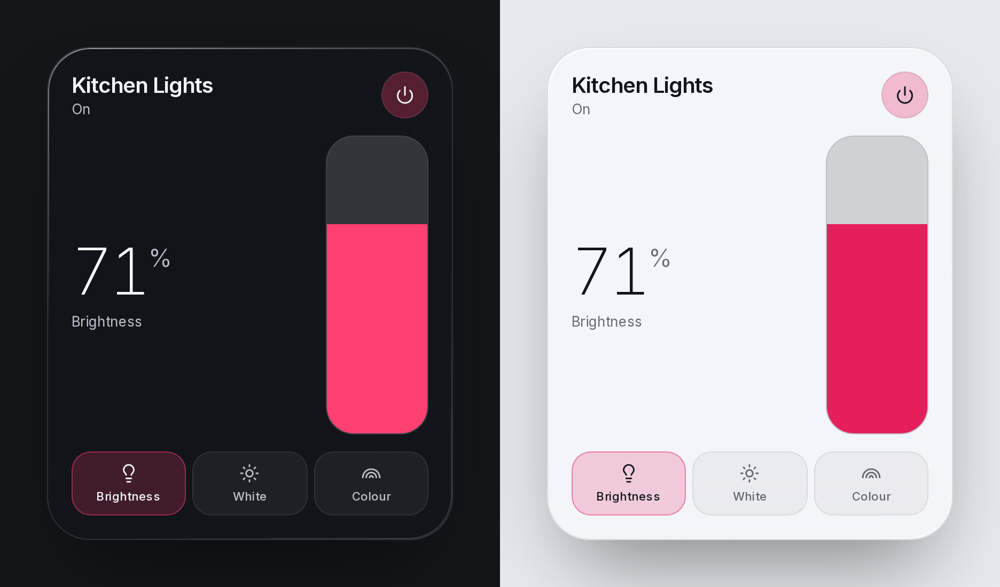

<div align="center">

<picture>
  <source media="(prefers-color-scheme: dark)" srcset="https://raw.githubusercontent.com/decibel95/liquid-home/main/docs/public/media/readme/hero-dark.png">
  <source media="(prefers-color-scheme: light)" srcset="https://raw.githubusercontent.com/decibel95/liquid-home/main/docs/public/media/readme/hero-light.png">
  
</picture>

# Liquid Home

Glass cards for Home Assistant lights: a light card, a tile, a badge and a room card.

[](LICENSE)
[](https://www.home-assistant.io)
[](https://github.com/decibel95/liquid-home/releases)

</div>

A liquid glass look for any `light` entity, with a visual editor for every card. Controls the light does not support are hidden. Light and dark glass follow your Home Assistant theme. Liquid Home is the sister card set of [Liquid Climate](https://github.com/decibel95/liquid-climate) and uses the same glass, so both sit side by side on one dashboard.

Version 0.2.1. Requires Home Assistant 2025.1.0 or newer.

## Features

- **Four cards.** A full light card, a compact tile, a badge for view badges or a grid, and a room card for all the lights of one room.
- **One pill for everything.** Drag the pill to set the brightness, the colour temperature or the colour. The mode buttons below it switch what it sets.
- **Only what your light can do.** A light that only switches on and off gets a toggle. White and Colour show up only when the light supports them. An effect chip shows up when the light has effects.
- **Calm service calls.** While you drag, at most one call goes out every 300 ms, plus a final one when you let go. The value you sent stays on screen until Home Assistant reports it back, so the pill never jumps back.
- **A sheet with a history button.** The tile, badge and room card open the light card as a sheet. Its history button takes you to the Home Assistant history of that light.
- **Visual editor.** Every card has a visual editor; a few options are YAML only.
- **Six languages.** English, Dutch, German, French, Spanish and Italian.
- **Works offline.** The Inter font ships with the cards, so they look the same on every device without an internet connection.

## Cards

### Light card

A full glass card for one light: a big vertical pill, a large readout, a power button and mode buttons. **Brightness** sets the brightness, **White** sets the colour temperature (the readout shows the warmth in kelvin) and **Colour** sets the hue. Each mode shows only when the light supports it, and you can pick the modes you want with `controls.modes`. A light with an effect list gets an effect chip, and a light group gets one chip per member.

<div align="center">
  <picture>
    <source media="(prefers-color-scheme: light)" srcset="https://raw.githubusercontent.com/decibel95/liquid-home/main/docs/public/media/readme/modes-light.png">
    
  </picture>
</div>

The drag is relative: the value moves by how far you move from where you grabbed, so a tap on the pill does not jump to that spot. With the keyboard, the arrow keys change the value by 1, Page Up and Page Down by 10, and Home and End jump to the ends. Releasing the pill at 0 % turns the light off.

### Tile

A compact glass row with a power button, the name and status, and brightness steppers (10 % per press). The power button is tinted with the light's colour while it is on. The status reads, for example, `On`, `On, 2631 K` or `2 of 3 on` for a light group. Tap the name and the light card opens as a sheet.

<div align="center">
  <picture>
    <source media="(prefers-color-scheme: light)" srcset="https://raw.githubusercontent.com/decibel95/liquid-home/main/docs/public/media/readme/tile-light.png">
    
  </picture>
</div>

### Badge

A glass pill with the light's icon, its name and one value: the brightness while on (or `On` for a light without brightness), `Off` or `Unavailable`. With `icon_only` it is a round icon. It works as a view badge and as a card in a grid. A tap opens the standard Home Assistant dialog, or the light card as a sheet with `tap_action: sheet`.

<div align="center">
  <picture>
    <source media="(prefers-color-scheme: light)" srcset="https://raw.githubusercontent.com/decibel95/liquid-home/main/docs/public/media/readme/badge-light.png">
    
  </picture>
</div>

### Room card

All the lights of a room in one card. The header shows the room name, how many lights are on and a power button for the whole room. Below it is a tile per light, and a strip with quick controls for the selected light: brightness steppers and White and Colour buttons that open the light card in that mode. Fill it from a Home Assistant area or from your own list of lights.

<div align="center">
  <picture>
    <source media="(prefers-color-scheme: light)" srcset="https://raw.githubusercontent.com/decibel95/liquid-home/main/docs/public/media/readme/room-light.png">
    
  </picture>
</div>

### The sheet and its history button

The tile, the badge (with `tap_action: sheet`) and the room card open the light card as a sheet, a dialog above the dashboard. Escape, the close button or a click outside closes it. Next to the close button sits a history button: it closes the sheet and opens the Home Assistant history page for that light. The button is always there in the sheet; there is no option to hide it, and the cards draw no history chart of their own.

<div align="center">
  <picture>
    <source media="(prefers-color-scheme: light)" srcset="https://raw.githubusercontent.com/decibel95/liquid-home/main/docs/public/media/readme/sheet-light.png">
    
  </picture>
</div>

## Installation

### Home Assistant Marketplace (recommended)

Home Assistant 2026.11 and newer has a built-in Marketplace under **Settings**, **Marketplace** (for administrators). Liquid Home is not in the Marketplace catalog yet, so you add it by link:

<div align="center">
  <picture>
    <source media="(prefers-color-scheme: dark)" srcset="https://raw.githubusercontent.com/decibel95/liquid-home/main/docs/public/media/readme/marketplace-entry-dark.png">
    
  </picture>
</div>

1. Open **Settings**, **Marketplace**. The first time, the Marketplace shows "Before you install from the Marketplace". Read it, tick "I understand the risks and agree" and select **Continue**.
2. Select **Add from link** at the top right. Adding by link needs a GitHub connection; the Marketplace asks you to connect GitHub if you have not yet.
3. Enter `https://github.com/decibel95/liquid-home` as the GitHub link and choose the type **Dashboard**.
4. Open **Liquid Home** and select **Install**. The dialog reads "This installs Liquid Home version ... in Home Assistant."
5. Reload your browser to load the new dashboard resource.

Once Liquid Home is in the Marketplace catalog you can also find it under **Browse**.

The Marketplace downloads all three release files (`liquid-home.js`, `liquid-inter.woff2` and `liquid-inter-OFL.txt`) into `/config/www/community/liquid-home/` and adds the dashboard resource for you, so the font works without extra steps. If your dashboards use YAML resources (`lovelace: resource_mode: yaml`), the Marketplace does not add the resource: add `/local/community/liquid-home/liquid-home.js` to your resources yourself, as a JavaScript module. The install dialog shows the exact URL to add.

### HACS

For older Home Assistant versions, or if you use [HACS](https://hacs.xyz):

1. Open HACS, the menu (three dots) at the top right, **Custom repositories**.
2. Add `https://github.com/decibel95/liquid-home` with the category **Dashboard**.
3. Open **Liquid Home**, select **Download**, then reload your browser.

HACS also downloads all three release files and adds the resource for you.

### Manual install

1. Download `liquid-home.js`, `liquid-inter.woff2` (the Inter font) and `liquid-inter-OFL.txt` (the font licence) from the [latest release](https://github.com/decibel95/liquid-home/releases/latest).
2. Copy all three into the same folder, for example `/config/www/liquid-home/`. The cards load the font from the folder next to `liquid-home.js`.
3. Open **Settings**, **Dashboards**, the menu (three dots), **Resources**, and add `/local/liquid-home/liquid-home.js?v=0.2.1` as a **JavaScript module**.
4. Hard refresh the browser (Ctrl+F5, or Cmd+Shift+R).

Home Assistant caches files in `/config/www` for a long time. The `?v=` at the end of the resource URL is a cache-buster: when you replace the files with a new version, change it to the new version number so every browser loads the new file. The font file picks up the same version.

Without `liquid-inter.woff2` next to `liquid-home.js` the cards still work. They fall back to an installed Inter or the system font.

### Add a card

Edit a dashboard, add a card and pick one of the Liquid Home cards. The badge is also in the badge picker (Edit dashboard, Badges).

| Picker name | Type |
|-------------|------|
| Liquid Home light card | `custom:liquid-home-light-card` |
| Liquid Home tile | `custom:liquid-home-tile` |
| Liquid Home badge | `custom:liquid-home-badge` |
| Liquid Home room | `custom:liquid-home-room` |

## Configuration

Every card has a visual editor, and a few options are YAML only (marked below). The options below are what the editor writes. Only `entity` is required on the light card, the tile and the badge. The room card needs an area or a list of lights. All four cards also take the `look` options, see [Theming](#theming).

### Light card options

| Option | Type | Default | Description |
|--------|------|---------|-------------|
| `entity` | string | required | A `light` entity |
| `name` | string | entity name | Name in the header |
| `controls.modes` | list | what the light supports | Any of `brightness`, `white`, `colour`. Modes the light does not support are ignored |
| `controls.effects` | boolean | `true` | Show the effect chip when the light has an effect list |
| `write_hold` | number | `10` | Seconds a sent value stays on screen while Home Assistant has not reported it back. Raise it for slow lights |
| `look` | object | | `glass`, `blur` and `motion`, see [Theming](#theming) |
| `config_version` | number | `1` | Written by the editor, leave it as it is |

```yaml
type: custom:liquid-home-light-card
entity: light.kitchen_lights
```

```yaml
type: custom:liquid-home-light-card
entity: light.living_room_rgbww_lights
name: Sofa
controls:
  modes: [brightness, white]
  effects: false
write_hold: 30
```

### Tile options

| Option | Type | Default | Description |
|--------|------|---------|-------------|
| `entity` | string | required | A `light` entity |
| `name` | string | entity name | Name on the tile |
| `tap_action` | string | `sheet` | Tap on the name: `sheet` (the light card as a sheet), `more-info` (the standard Home Assistant dialog) or `none` |
| `write_hold` | number | `10` | Seconds a sent value stays on screen while Home Assistant has not reported it back |
| `controls.modes` | list | what the light supports | YAML only. Passed on to the light card sheet: `brightness`, `white`, `colour` |
| `controls.effects` | boolean | `true` | YAML only. Passed on to the light card sheet: the effect chip |
| `look` | object | | `glass`, `blur` and `motion`, see [Theming](#theming) |
| `config_version` | number | `1` | Written by the editor |

`controls.modes` and `controls.effects` change only the sheet the tile opens, not the tile itself.

```yaml
type: custom:liquid-home-tile
entity: light.ceiling_lights
```

```yaml
type: custom:liquid-home-tile
entity: light.living_room_rgbww_lights
name: Sofa
tap_action: sheet
controls:
  modes: [brightness, white]
```

### Badge options

| Option | Type | Default | Description |
|--------|------|---------|-------------|
| `entity` | string | required | A `light` entity |
| `name` | string | entity name | Name on the badge |
| `tap_action` | string | `more-info` | Tap on the badge: `more-info`, `sheet` (the light card as a sheet) or `none` |
| `icon_only` | boolean | `false` | Show only the round icon. Its accessible name still reads the name and the value |
| `look` | object | | `glass`, `blur` and `motion`, see [Theming](#theming) |
| `config_version` | number | `1` | Written by the editor |

```yaml
# In the view badges
badges:
  - type: custom:liquid-home-badge
    entity: light.ceiling_lights
```

```yaml
type: custom:liquid-home-badge
entity: light.ceiling_lights
name: Ceiling
icon_only: true
tap_action: sheet
```

### Room card options

| Option | Type | Default | Description |
|--------|------|---------|-------------|
| `title` | string | area name | Title in the header. Without a title, an area card reads the area name and a list card reads `Lights` |
| `source` | string | inferred | `area` or `list`. When it is missing, a list of `entities` means `list`, otherwise `area`. The editor always writes it |
| `area` | string | | With `source: area`: the area id. The card lists every light in that area, by the light's own area or its device's area. Hidden and disabled lights are left out |
| `entities` | list | | With `source: list`: the lights, in order. Each item is an entity id, or `entity` plus an optional `name` |
| `exclude` | list | `[]` | Lights to leave out, for both sources |
| `power_entity` | string | | A light entity, normally a light group, for the header power button. With it the button sends one call to that entity and its state decides the button. Without it, one call goes to all available lights of the card |
| `look` | object | | `glass`, `blur` and `motion`, see [Theming](#theming) |
| `config_version` | number | `1` | Written by the editor |

The header power button turns the room off when any light is on, and on otherwise. A power entity is left out of the tiles of an area card, since the button already stands for it.

```yaml
type: custom:liquid-home-room
source: area
area: living_room
exclude:
  - light.hallway_night_light
```

```yaml
type: custom:liquid-home-room
title: Living Room
source: list
power_entity: light.living_room_lights
entities:
  - light.ceiling_lights
  - entity: light.living_room_rgbww_lights
    name: Sofa
```

## Visual editor

Every card has a visual editor in the Home Assistant card editor. The light card editor has three tabs: **Setup** (the light and its name), **Controls** (modes, the effect chip and how long a sent value stays on screen) and **Look** (glass, blur and motion). The room card editor has an area picker with a switch per light, or a list of lights with names, Up, Down and Remove. The (?) links in the editor open the matching section of the [documentation](https://decibel95.github.io/liquid-home/). The editor writes only the options you changed, plus the card type, the entity and a config version. The room card editor also writes `source`.

## Theming

All four cards use the same glass and the same theme variables as Liquid Climate, so one theme setting moves both. card-mod is not needed.

<div align="center">
  
</div>

Set these under `look` on any Liquid Home card:

| Option | Type | Default | Description |
|--------|------|---------|-------------|
| `look.glass` | string | `theme` | `theme` follows Home Assistant: dark glass when Home Assistant is in dark mode or the theme has a dark background colour, light glass otherwise. `dark` or `light` forces one |
| `look.blur` | number | `30` | Backdrop blur in px. `0` turns the blur off, which helps on slow devices |
| `look.motion` | string | `rich` | `rich`, `subtle` or `minimal`. `minimal` removes the fill transition of the pill and the sheet animation |

```yaml
type: custom:liquid-home-light-card
entity: light.kitchen_lights
look:
  glass: dark
  blur: 40
  motion: subtle
```

You can also set CSS variables in your Home Assistant theme. They are the same `--lc-*` names Liquid Climate reads:

| Variable | Effect |
|----------|--------|
| `--lc-blur` | Backdrop blur, for example `30px`. Overrides `look.blur` |
| `--lc-radius` | Card corner radius. Defaults: light card `40px`, tile `26px`, room card `36px`. The badge does not use it |

```yaml
my-glass-theme:
  lc-blur: 24px
  lc-radius: 28px
```

Home Assistant turns each theme key into a CSS variable with the `--` prefix, so `lc-radius` becomes `--lc-radius`.

## Languages

`en`, `nl`, `de`, `fr`, `es`, `it`: English, Dutch, German, French, Spanish and Italian. The cards follow the language of your Home Assistant profile and fall back to English. To fix or add a translation, see [CONTRIBUTING-translations.md](CONTRIBUTING-translations.md).

## Documentation

The full documentation is at **[decibel95.github.io/liquid-home](https://decibel95.github.io/liquid-home/)**.

| Page | Covers |
|------|--------|
| [Getting started](https://decibel95.github.io/liquid-home/getting-started) | Install, first card |
| [Light card](https://decibel95.github.io/liquid-home/cards/light) | Behaviour, how changes are sent, options, editor |
| [Tile](https://decibel95.github.io/liquid-home/cards/tile) | Behaviour, options, editor |
| [Badge](https://decibel95.github.io/liquid-home/cards/badge) | Behaviour, options, editor |
| [Room card](https://decibel95.github.io/liquid-home/cards/room) | Sources, power entity, options, editor |
| [Theming](https://decibel95.github.io/liquid-home/theming) | Glass, blur, motion, CSS variables |
| [Languages](https://decibel95.github.io/liquid-home/languages) | Translations |
| [Troubleshooting](https://decibel95.github.io/liquid-home/troubleshooting) | Common problems, reporting a bug |

## Liquid Climate and liquid-core

Liquid Home is the sister card set of [Liquid Climate](https://github.com/decibel95/liquid-climate), glass cards for climate entities, water heaters and humidifiers. Both use the same glass, the same theme variables and the same Inter font, and run side by side on one dashboard. Each is its own resource, so you can install one or both.

The shared parts (the glass, the pill, the sheet, the font and the shared translations) live in the [liquid-core](https://github.com/decibel95/liquid-core) library. It comes from npm as [@decibel95/liquid-core](https://www.npmjs.com/package/@decibel95/liquid-core) and is bundled into `liquid-home.js`, so there is nothing extra to install.

## Contributing

Translations are welcome, see [CONTRIBUTING-translations.md](CONTRIBUTING-translations.md). For bugs, open an issue on [GitHub](https://github.com/decibel95/liquid-home/issues) with the card version and your card config.

For development:

```
npm ci
npm run dev        # dev harness with fake lights at http://localhost:5198/dev/
npm run typecheck
npm test
npm run build      # dist/liquid-home.js, plus liquid-inter.woff2 and liquid-inter-OFL.txt from liquid-core
npm run size       # raw and gzip size against the budget
npm run docs:dev
```

## License

[MIT](LICENSE)

The line icons come from [Lucide](https://lucide.dev), under the ISC licence. The Inter font (`liquid-inter.woff2`) is under the SIL Open Font License 1.1, and its licence text ships next to it as `liquid-inter-OFL.txt` in every release. See [NOTICE](NOTICE) for both.
